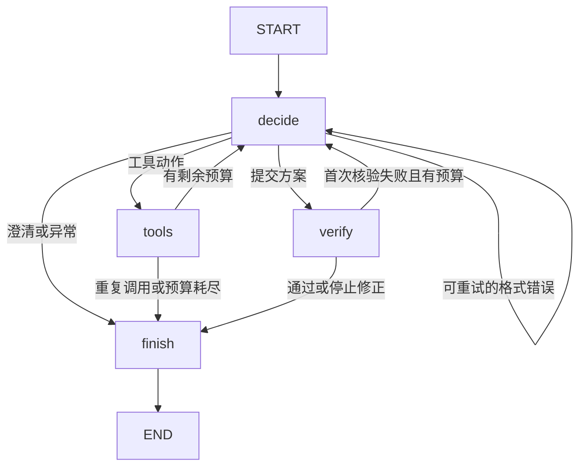

# LangGraph校园办事智能体

## 当前实现

智能办事采用 **LangGraph 1.2.6** 的 `StateGraph` 编排。模型、工具和方案核验分别在独立节点运行，条件边负责继续、修正或结束。原手写循环已移除，未保留另一套运行分支。

| 节点 | 职责 | 后续路径 |
| --- | --- | --- |
| decide | 检查时间与决策预算，调用JsonPlanner，校验tool/clarify/finish动作 | tools、verify、自身或finish |
| tools | 工具白名单与参数验证，实际调用，编号和整理证据，将观察写入状态 | decide或finish |
| verify | 检查办理步骤、引用、数字、业务时间及部分条件；核验失败反馈修正 | decide或finish |
| finish | 汇总办理建议或已有依据、澄清、缺失事项及停止原因 | END |



实际编译图可从 `AgentRuntime(...).graph.get_graph()` 取得；`report_work/langgraph_validation/workflow.mmd` 为联调时由该对象直接导出的结构。

## 源码位置

- `core/agent/runtime.py`：StateGraph构建、四节点、条件边、有限执行与结果兼容入口。
- `core/agent/state.py`：单次运行的任务、消息、证据、步骤、停止状态等TypedDict定义。
- `core/agent/planner.py`：原云端Chat Completions与本地Ollama适配，保持JSON决策契约。
- `core/agent/contracts.py`：Pydantic动作及工具参数校验。
- `core/agent/tools.py`：search_knowledge、lookup_place、plan_route、current_time四类只读工具。
- `core/agent/answer.py`：现有方案证据核验与输出。
- `web/agent_api.py`、`core/agent/store.py`：原接口、服务端会话历史与SQLite保存。

## 安装与使用

在项目根目录执行：

```powershell
python -m pip install -r requirements.txt
python main.py --web --port 8000
```

Windows仍可双击 `start_web.bat`。浏览器访问 `http://127.0.0.1:8000`。若改造前服务仍在运行，先在原终端按Ctrl+C，再重新启动。脚本优先使用 `D:\anaconda\anaconda\envs\pytorch\python.exe`；本次该环境已经安装LangGraph 1.2.6，无需另装独立服务。当前requirements将LangGraph限制为 `>=1.2.6,<1.3`，Python需3.10及以上。

模型配置与原界面相同：设置兼容云端模型与Key，或启用本地Ollama，再选择“智能办事”。LangGraph无需账号或云端部署。当前验证环境没有启用LangSmith跟踪；若部署环境自行开启跟踪变量，应另行核对其数据发送设置。

## 保持兼容的行为

`AgentRuntime.run(question, history)`、`POST /api/agent/chat` 和现有回答字段继续使用。普通RAG、地图、配置界面、办事卡片及工具轨迹格式不变。原结果组装函数与改造前保持一致，新增三个agent字段：

```json
{
  "framework": "LangGraph",
  "framework_version": "1.2.6",
  "graph_nodes": ["decide", "tools", "decide", "verify", "finish"]
}
```

`graph_nodes`只记录节点名，不包含模型思维链，既有`trace`继续记录工具和校验结果。

## 步数 超时与会话

- 默认8次预算统计的是模型决策次数；一次决策后可能再执行工具或核验节点。LangGraph的`recursion_limit`按 `max(8, max_steps*3+4)`设置，作为图调度的额外边界，不替代业务决策上限。
- 90秒预算沿用单调时钟；模型与工具仍由原bounded_call控制等待和在途任务数量。超时后底层线程可能继续直至结束，迟到结果不再用于当前回复。
- 每次调用建立独立图状态，没有开启checkpointer或跨用户共享状态。SQLite仍是会话历史来源，客户端history不覆盖服务端历史。
- 会话清空的版本检查保持有效：执行期间清空后，迟到结果返回session_cleared且不会重新保存。
- 工具白名单、参数检查、敏感参数脱敏和证据核验继续生效；规则核验不等同完整语义正确性保证。

## 验证与证据

```powershell
python -m unittest discover -s tests -v
node --test tests/test_chat_ui.cjs tests/test_agent_ui.cjs
python eval/agent_evaluate.py
python scripts/verify_langgraph.py
```

新增 `tests/test_agent_graph.py` 共13项，覆盖实际CompiledStateGraph与节点流、方案修正、8次和30次决策预算、无效输出、模型/工具超时、运行复用、并发隔离、接口元数据及执行中清空。

2026年10月28日迁移验证：原基线Python 171项、Node 22项；迁移后Python 184项、Node 22项；离线执行器14/14。本地HTTP联调使用真实知识库（29,427个文本块）和全部四类只读工具，经过6次脚本模型请求形成有引用的方案，并验证路线及临时会话数据库读写与清空。

结果位于 `report_work/langgraph_validation/`：

- `integration.json`：本地HTTP工具联调结果及节点路径。
- `offline-results.json`：14项固定执行器场景。
- `workflow.mmd`：从实际编译图导出的Mermaid结构。
- `python-tests.log`、`node-tests.log`：完整回归日志。

本地脚本模型联调验证接口、框架及工具接线，未测试真实模型自主任务成功率。真实模型测试继续使用 `eval/agent_evaluate.py --live` 或页面实际任务，需可用模型配置并另行保存执行记录。旧页面截图保留为原版本记录；新框架办事过程应重新运行后采集。

## 备份

改造前的runtime.py、requirements.txt和README.md备份于 `report_work/langgraph_migration_backup/`。课程报告、Word参赛报告、学校资料及原始截图本轮未修改。
